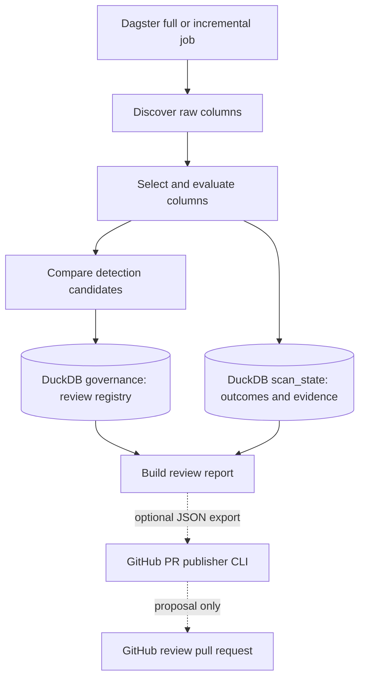
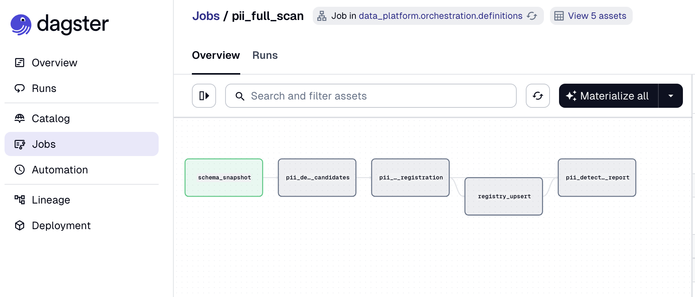

# PII discovery scanner

This is a small, runnable recreation of a PII discovery and governance workflow I designed and worked on in production. I rebuilt it with synthetic data and DuckDB rather than share proprietary source code or depend on internal services. The original environment used Dagster, Snowflake and dbt, with additional downstream governance automation.

The interesting problem isn't matching an email address. It's discovering columns as schemas change, keeping a record of what was actually evaluated, retrying failed work, and **not overwriting human review decisions** when detection runs again.

## Run it locally

Requires Python 3.12+ and [uv](https://docs.astral.sh/uv/).

```bash
uv sync --group dev
uv run python scripts/seed_database.py
uv run dagster dev -m data_platform.orchestration.definitions
```

Open the Dagster UI and materialize the `pii_full_scan` job. The seed script writes to `data/warehouse.duckdb`; the configured Dagster warehouse path must point to the same file (see `src/data_platform/platform/config.py`). The seed script replaces synthetic `raw` tables; it does not reset governance decisions.

To review a registered finding:

```bash
uv run python scripts/review_pii.py --help
uv run python scripts/review_pii.py accept customers email_address --reviewed-by YOUR_ID
```

Run the incremental job after a full scan to see structurally unchanged columns skipped. Adding a column or changing its data type causes the incremental job to evaluate it. Data-only changes do **not** trigger an incremental rescan; run the full job when freshness matters.

```bash
uv run ruff check .
uv run ruff format --check .
uv run pytest -q
```

## How it works



The Dagster asset sequence is:
 `schema_snapshot` → `pii_detection_candidates` → `pii_candidates_for_registration` → `registry_upsert` → `pii_detection_report`



 Domain code lives under `src/data_platform/projects/pii_scanner/` - the Dagster layer coordinates it rather than containing all the business logic.

- **`raw`** holds synthetic source tables.
- **`scan_state`** holds scan runs and per-column observations, including failures and intentional skips. Skipped columns retain provenance to their last actual evaluation.
- **`governance`** holds the canonical registry and human acceptance/rejection decisions. Automated rescans do not reset them.

There are 2 dagster jobs:
- A full scan evaluates every discovered column. 
- An incremental scan uses prior successful evaluation metadata to skip structurally unchanged columns. 

Retries within the **same Dagster run** reuse completed observations and reevaluate pending/failed work. This is not general cross-run crash recovery.

- job scheduling is not included in this sample

## Optional GitHub and dbt governance workflow

The scanner runs locally without GitHub, dbt, or AWS. The optional downstream path now follows the **original production design**: accepted PII findings + dbt model metadata → minimal schema YAML edits → `{path: content}` mapping → Git blob hash diff → bounded Git tree batches → one commit → human-review PR. This is a reduced local adaptation; no automatic masking is applied.

- `scripts/plan_dbt_masking.py`: offline plan for accepted records and dbt metadata; outputs a JSON plan when `--output` is supplied.
- `scripts/publish_review_pr.py`: optional standalone report PR; dry-run is offline and does not need credentials.
- `core/github_dbt_pr.py` and `core/github_tree_commit.py`: shared production-pattern multi-file PR writer (used by the report CLI and downstream asset).
- `orchestration/assets/pii_dbt_publish.py`: optional separate Dagster publishing asset, available when `GITHUB_TOKEN` is configured; defaults to `publish=False`.
- `orchestration/resources/github.py`: injected PyGithub client with bounded retries.

Example offline dbt plan (inputs must be explicitly human-accepted records, not raw detector candidates):

```bash
uv run python scripts/plan_dbt_masking.py accepted.json dbt_models.json /path/to/dbt/checkout --output dbt_plan.json
```

Example report PR preview (no GitHub token needed):

```bash
uv run python scripts/publish_review_pr.py report.json --owner YOUR_ORG --repo YOUR_REPO
```

For a real PR, set `GITHUB_TOKEN` and add `--publish` (test repository first). The `pii_dbt_masking_pr` asset can publish an explicitly prepared plan with `publish=True`; it is **not** a dependency of the scanner's main job. See [dbt/GitHub workflow](docs/architecture/github_dbt_workflow.md) for the full design and limitations.

## Engineering notes

- [Architecture and diagram](docs/architecture/README.md)
- [Technical design](docs/architecture/technical_design.md)
- [GitHub PR and dbt workflow](docs/architecture/github_dbt_workflow.md)
- [Orchestration Design and Productio vs Sample Differences](docs/architecture/orchestration_design_and_production_differences.md)

## Limits

The detector currently focuses on email/phone signals and column names, not a comprehensive PII taxonomy. Sampling with `LIMIT` is biased toward early rows. A positive match is a review candidate, not proof of PII. The local implementation assumes serial scan runs and a single DuckDB catalog; it does not demonstrate Spark/EMR, warehouse-scale performance, distributed execution, production masking, or concurrency-safe registry writes. See the design docs for the implications.

