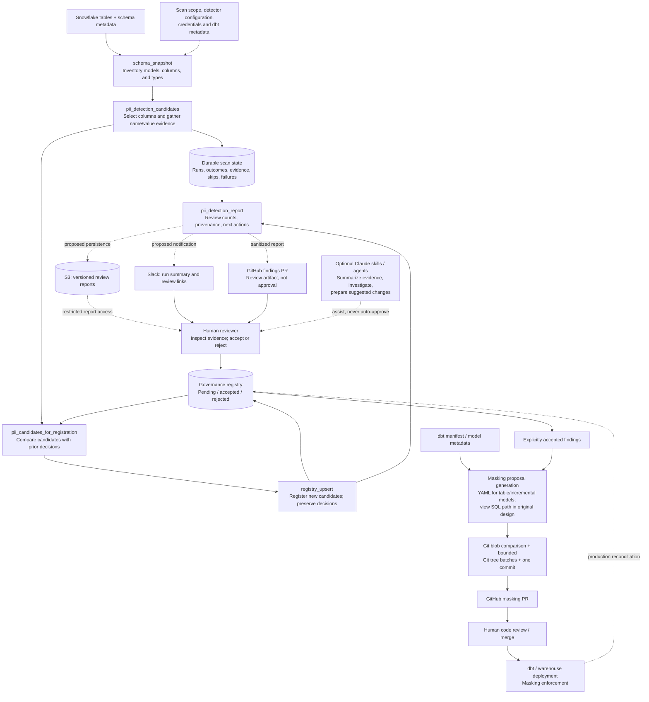
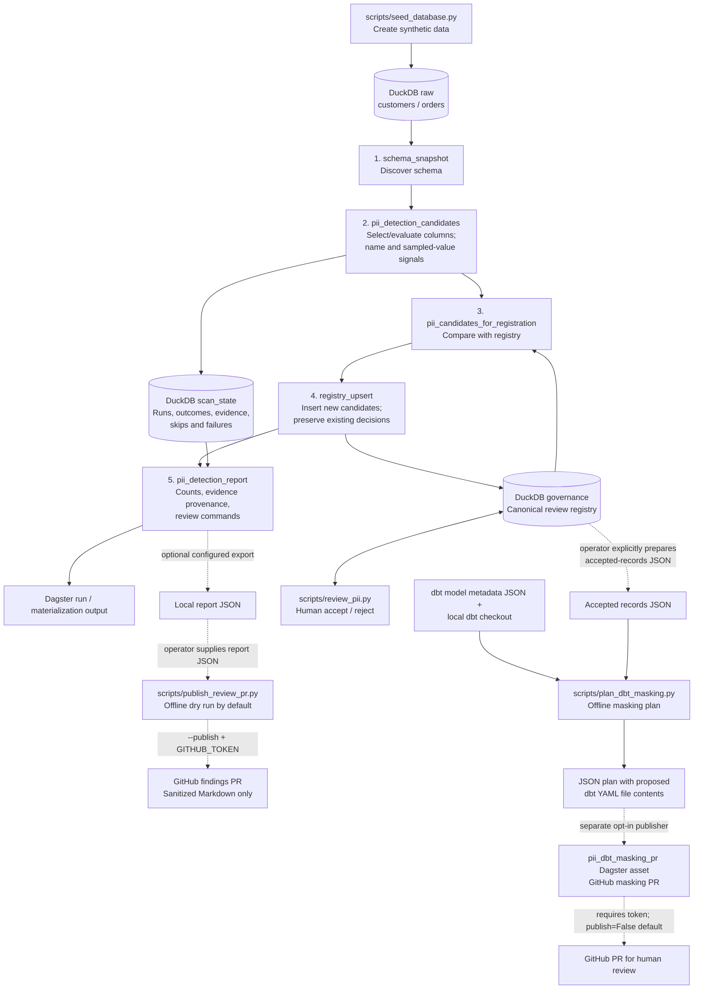

# PII discovery scanner

This is a small, runnable recreation of a PII discovery and governance workflow I designed and worked on in production. I rebuilt it with synthetic data and DuckDB rather than share proprietary source code or depend on internal services. The original environment used Dagster, Snowflake and dbt, with additional downstream governance automation.

The interesting problem isn't matching an email address. It's discovering columns as schemas change, keeping a record of what was actually evaluated, retrying failed work, and **not overwriting human review decisions** when detection runs again.

## Production architecture (reference design)

The original system used Dagster, Snowflake, and dbt. The diagram below describes the intended end-to-end operating model, including optional S3, Slack, and Claude-assisted review handoffs. These integrations are **not all implemented or verified in this local recreation**. Automated detection proposes classifications; it does not approve them or apply masking.



**Production handoffs.** Scan state preserves what was actually evaluated, including skipped and failed columns. The governance registry independently records human decisions so later scans cannot silently overwrite them. A report can be persisted to S3 and linked from Slack; reviewers decide classifications in an authorized review workflow. Claude skills or agents may help interpret evidence or draft changes, but should not be treated as the approval authority. Only explicitly accepted findings proceed to a masking proposal. A GitHub PR is a review checkpoint, not a deployed masking policy. The original production design included separate view-SQL handling and PR-status reconciliation; neither is implemented in the local sample.

## Local architecture (implemented sample)

This repository runs without Snowflake, S3, Slack, Claude, GitHub credentials, or a dbt installation. DuckDB is both the synthetic source warehouse and the persistent local state store. Dagster coordinates five assets; downstream GitHub and dbt tools are deliberately separate and opt-in.



**What is stored where:** `data/warehouse.duckdb` contains `raw` source tables, `scan_state` evaluation history, and `governance` decisions. Dagster records runs and asset materializations using its configured local storage. `pii_detection_report` produces a report through Dagster; a local JSON export is optional, not an automatic S3 upload. The dbt planner writes a JSON plan only when `--output` is supplied. Neither GitHub publisher writes remotely unless explicitly enabled. The scanner does not automatically export accepted registry records, resolve a dbt manifest, or apply masking.

**Full versus incremental:** Both jobs use the same five-asset flow. A full scan reevaluates discovered columns. An incremental scan skips structurally unchanged columns based on prior successful evaluations; adding a column or changing its type triggers evaluation. Data-only changes do not trigger incremental rescanning. Skips retain the provenance of the last actual evaluation. Retries within the same Dagster run reuse completed observations and reevaluate pending or failed work; this is not general cross-run crash recovery.

## Run the sample end to end

Requires Python 3.12+ and [uv](https://docs.astral.sh/uv/). Run commands from the repository root.

**1. Install and seed synthetic tables.** The seed script replaces `raw` tables but does not clear governance decisions. The Dagster warehouse path must match the seed script's `data/warehouse.duckdb` (see `src/data_platform/platform/config.py`).

```bash
uv sync --group dev
uv run python scripts/seed_database.py
```

**2. Run the scanner.** Use the CLI below, or start `uv run dagster dev -m data_platform.orchestration.definitions` and materialize `pii_full_scan` in the UI.

```bash
uv run dagster job execute -m data_platform.orchestration.definitions -j pii_full_scan
```

Inspect the `pii_detection_report` asset output for new and pending findings, evidence provenance, and suggested review commands. The first run registers candidates; subsequent full runs should not duplicate them.

**3. Record a human decision.** The CLI updates the DuckDB governance registry, not a GitHub PR. Use the actual candidate model/field from your report.

```bash
uv run python scripts/review_pii.py accept customers email_address --reviewed-by YOUR_ID
# Optional example of a rejected candidate:
# uv run python scripts/review_pii.py reject customers phone_number --reviewed-by YOUR_ID
```

Rerun `pii_full_scan` to verify that accepted or rejected decisions remain intact. Then try the incremental job:

```bash
uv run dagster job execute -m data_platform.orchestration.definitions -j pii_incremental_scan
```

**4. Preview a GitHub findings PR (optional).** `publish_review_pr.py` expects a **report JSON file** containing `pending_review` entries with `model`, `field`, and `pii_type`. The CLI does not automatically extract the current Dagster report; supply a suitable JSON file or use a configured export. Its Markdown renderer intentionally excludes sampled PII values.

```bash
uv run python scripts/publish_review_pr.py report.json \
  --owner YOUR_ORG --repo YOUR_REPO
```

Without `--publish`, this is an **offline dry run**: it validates and lists the proposed `governance/pii-review.md` file but does not calculate a remote diff, commit, or open a PR. To actually publish, provide a repository-scoped `GITHUB_TOKEN` and add `--publish`; use a test repository first. A findings PR is for human inspection and does **not** itself update the DuckDB review registry.

**5. Generate a dbt masking proposal (optional).** This is a *different* workflow. Supply a JSON array of **explicitly human-accepted** records (`model`, `field`, optionally `policy`), a JSON array of dbt model metadata (`model`, `patch_path`, `materialization`), and a local dbt checkout containing the referenced YAML files. The planner does not query DuckDB or parse the dbt manifest automatically.

```bash
uv run python scripts/plan_dbt_masking.py \
  accepted.json dbt_models.json /path/to/dbt/checkout \
  --output dbt_plan.json
```

For supported `table` and `incremental` models, the proposed YAML adds `config.meta.masking_policy` and `contains_pii: true` to matching columns. Unsupported materializations, missing paths, or unsafe edits are flagged rather than silently applied. The input dbt checkout remains unchanged. The output is a proposed file-content plan, **not an enforced warehouse policy**.

**6. Optionally publish the dbt plan.** The separate `pii_dbt_masking_pr` Dagster asset is available when `GITHUB_TOKEN` is configured and consumes an explicitly prepared plan. Its `publish` setting defaults to `False`; it is **not part of either scanner job**. The shared GitHub writer compares blob hashes, batches Git tree updates, and creates or reuses a human-review PR when publication is enabled. Merging and deploying dbt/warehouse changes is outside this sample.

**7. Verify before submitting.**

```bash
uv run ruff check .
uv run ruff format --check .
uv run pytest -q
```

### Boundaries and safety

The detector focuses on column names and email/phone signals, with early-row `LIMIT` sampling. Findings are suggestions, not proof of PII. The sample assumes serial scans and a single DuckDB catalog; it does not demonstrate Spark/EMR, distributed execution, warehouse-scale performance, concurrent registry writes, live GitHub integration, S3 report persistence, Slack notifications, Claude automation, or masking enforcement. Never publish raw sampled PII. See [technical design](docs/architecture/technical_design.md), [GitHub/dbt workflow](docs/architecture/github_dbt_workflow.md), and [production differences](docs/architecture/orchestration_design_and_production_differences.md).

## Engineering notes

- [Architecture and diagram](docs/architecture/README.md)
- [Technical design](docs/architecture/technical_design.md)
- [GitHub PR and dbt workflow](docs/architecture/github_dbt_workflow.md)
- [Orchestration Design and Productio vs Sample Differences](docs/architecture/orchestration_design_and_production_differences.md)

## Limits

The detector currently focuses on email/phone signals and column names, not a comprehensive PII taxonomy. Sampling with `LIMIT` is biased toward early rows. A positive match is a review candidate, not proof of PII. The local implementation assumes serial scan runs and a single DuckDB catalog; it does not demonstrate Spark/EMR, warehouse-scale performance, distributed execution, production masking, or concurrency-safe registry writes. See the design docs for the implications.

