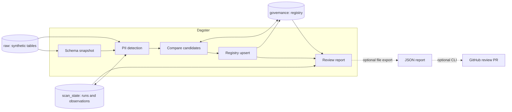

# Architecture

The local project is one Python application orchestrated by Dagster, backed by one DuckDB file. The boxes below are logical boundaries, not separate services.

## Boundaries

**Orchestration:** `src/data_platform/orchestration/` defines assets, jobs, and the DuckDB resource. `pii_full_scan` evaluates every discovered column; `pii_incremental_scan` selects based on previous actual evaluations.

**Domain logic:** `src/data_platform/projects/pii_scanner/` discovers columns, samples values, detects and classifies candidate types, records observations, compares candidates with the registry, and builds the review report.

**Persistence:** `raw` contains seed data; `scan_state` records execution history and evidence; `governance` stores current human decisions. Keeping the registry separate from scan history is essential: a rescan must not silently reverse a reviewer.

**Optional publishing:** `core/github_review.py` renders a sanitized Markdown summary; `core/github_dbt_pr.py` and `core/github_tree_commit.py` publish using the shared multi-file Git tree writer. `scripts/publish_review_pr.py` is the opt-in report entry point; an optional Dagster asset publishes explicitly supplied dbt plans. No GitHub call is made during ordinary scanning.

## Reading order

Start with the [README](../../README.md), then the [technical design](technical_design.md) for architecture, decisions, production adaptations, and limitations. The [GitHub/dbt workflow](github_dbt_workflow.md) covers the optional publishing workflow.
