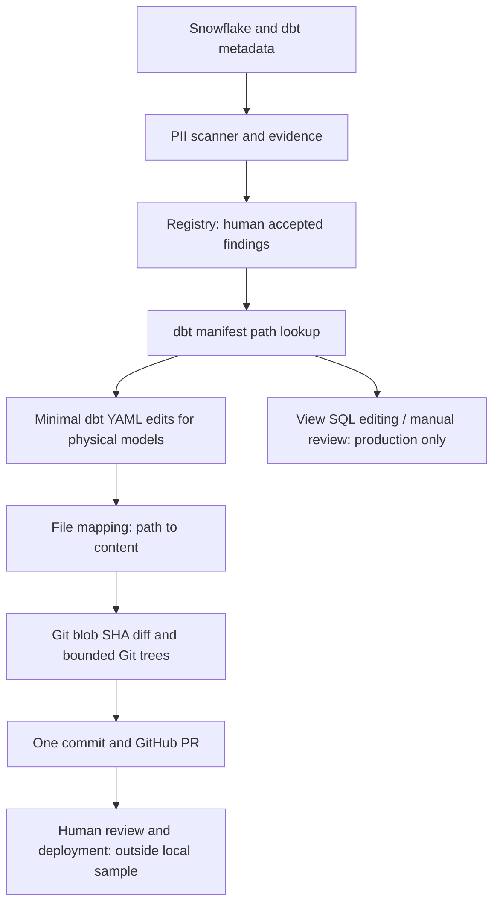

# dbt masking proposals and GitHub review

This project recreates the core *pattern* from the original production PII governance implementation. The source reference is the original `dagster_project` modules `pii_masking_pr.py`, `dbt_yaml_edit.py`, `github_tree_commit.py`, `github_dbt_pr.py`, and `github_resource.py`. The local code is a reduced adaptation, not the full Snowflake/dbt deployment.

## Production design and why it mattered

1. Dagster discovered PII candidates from Snowflake and dbt metadata. The registry stored human accepted/rejected decisions independently from detector output.
2. Only **accepted, pending** columns entered the masking proposal flow. dbt manifest metadata resolved model names to schema YAML paths and materialization types.
3. Physical `table` and `incremental` columns received proposed `config.meta.masking_policy` and `contains_pii` YAML changes. The editor inserted small blocks rather than round-tripping/reformatting YAML. Existing config that could not be safely merged was flagged.
4. View models followed a separate SQL `mask_pii()` editing path in production, with an editor and manual fallback. **That path is intentionally not included locally.**
5. The generated `{repository_path: complete_file_content}` mapping passed to a reusable GitHub PR writer. It compared Git blob SHA values against the Git tree, skipped identical files, chained bounded tree batches, and created **one commit** regardless of how many generated files changed. The original design addressed a real ~5,260-file case in which per-file API writes would have required thousands of requests.
6. GitHub PR review was a human checkpoint. A PR did not apply masking until the relevant dbt/Snowflake changes were merged and deployed. Production also reconciled PR status back to the registry.

## What the local code now implements

- `core/dbt_yaml_edit.py`: adapted deterministic YAML editor. Existing configuration is flagged rather than silently merged.
- `core/dbt_masking_plan.py`: pure planning from explicitly human-accepted records and dbt model metadata; physical models only. **It does not query the registry or a dbt manifest itself.**
- `core/github_tree_commit.py`: Git blob hash comparison, bounded multi-file Git tree writes, single commit, non-forced branch updates, and truncated-tree handling. Unlike the original force-reset behavior, it preserves existing review branch history.
- `core/github_dbt_pr.py`: dry-run, PR creation/reuse, and updating the content of an existing PR branch.
- `orchestration/resources/github.py`: Dagster `GitHubResource` with bounded HTTP retries and timeouts; registered only when `GITHUB_TOKEN` is present.
- `orchestration/assets/pii_dbt_publish.py`: separate opt-in downstream Dagster asset that reads an explicit plan JSON. `publish=False` by default.
- `scripts/plan_dbt_masking.py`: local offline planner for human-accepted records and dbt model metadata.
- `scripts/publish_review_pr.py`: optional standalone Markdown report PR using the **same** production-pattern writer; dry-run does not need a token.

## Intentional boundaries and risks

The scanner's local DuckDB registry is not automatically translated into dbt manifest mappings; an operator must supply accepted records and model metadata to the planner. The local sample does not generate view SQL, deploy Snowflake masking policies, or reconcile merged PRs to registry state. The GitHub integration has mocked tests, not a live-repository integration test. A simultaneous branch writer may still cause a conflict, which should fail rather than force-overwrite the branch. GitHub publishing remains separate from the scan so network failures do not invalidate successful detection.

**Security:** Never publish raw sampled PII. A PR is a proposal, not an approval or an enforcement step. Review generated YAML before publishing and restrict token permissions to the target repository.
